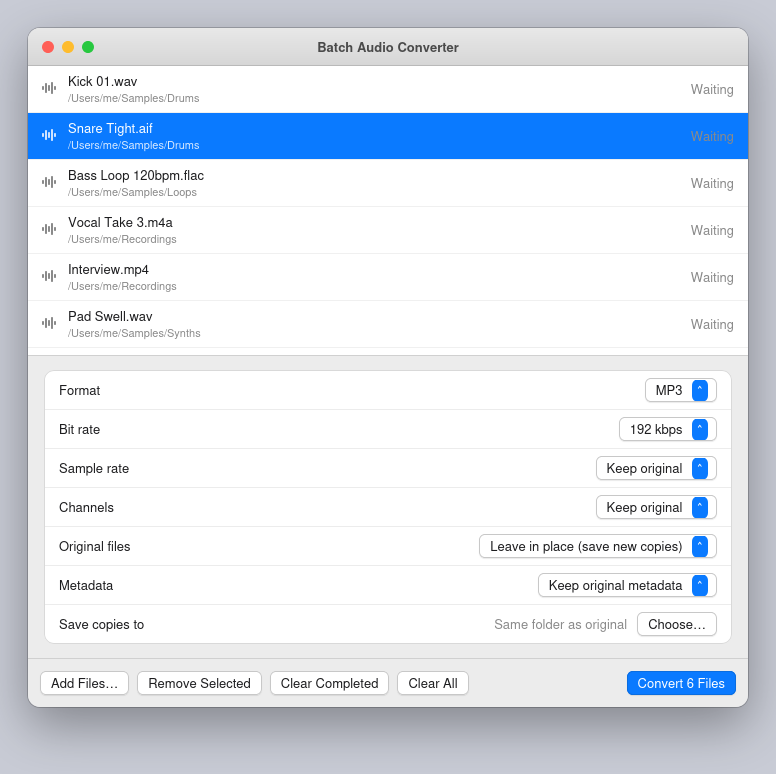

# Batch Audio Converter

Simple macOS (13+) app for batch-converting audio files. Drag in files or folders, pick format, bit rate / bit depth, sample rate and channels (mono/stereo), choose whether to keep or replace the originals and whether to keep or clear metadata. Uses ffmpeg under the hood.



## Build
```
brew install ffmpeg
bash build_app.sh
```
Produces `Batch Audio Converter.app`; drag it to Applications.

## Documentation
See the **[User Manual](docs/MANUAL.md)** for a walkthrough with screenshots.

## Disclaimer
This software is provided **"as is", without warranty of any kind**. The authors are not liable for any loss or damage, including lost or overwritten files. Back up your audio before converting, especially when using "Replace".

## License
[MIT](LICENSE). ffmpeg is a separate program with its own license and is not included.
