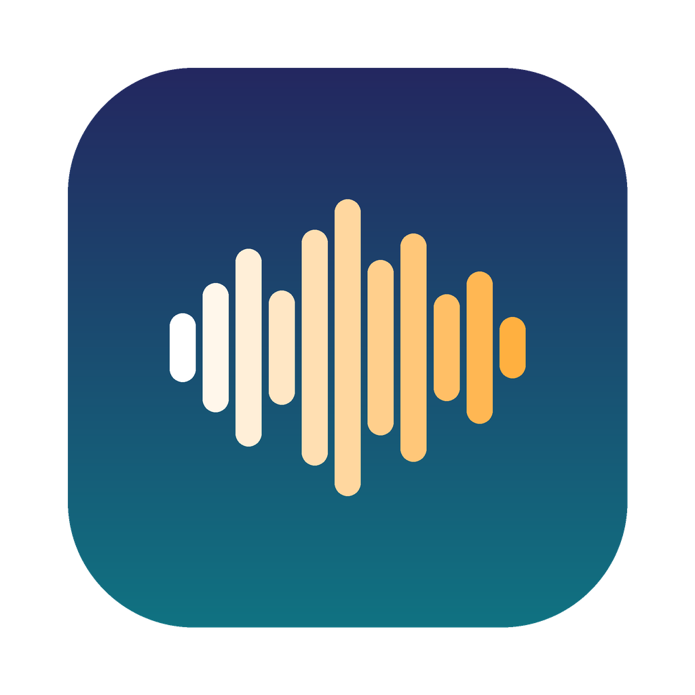
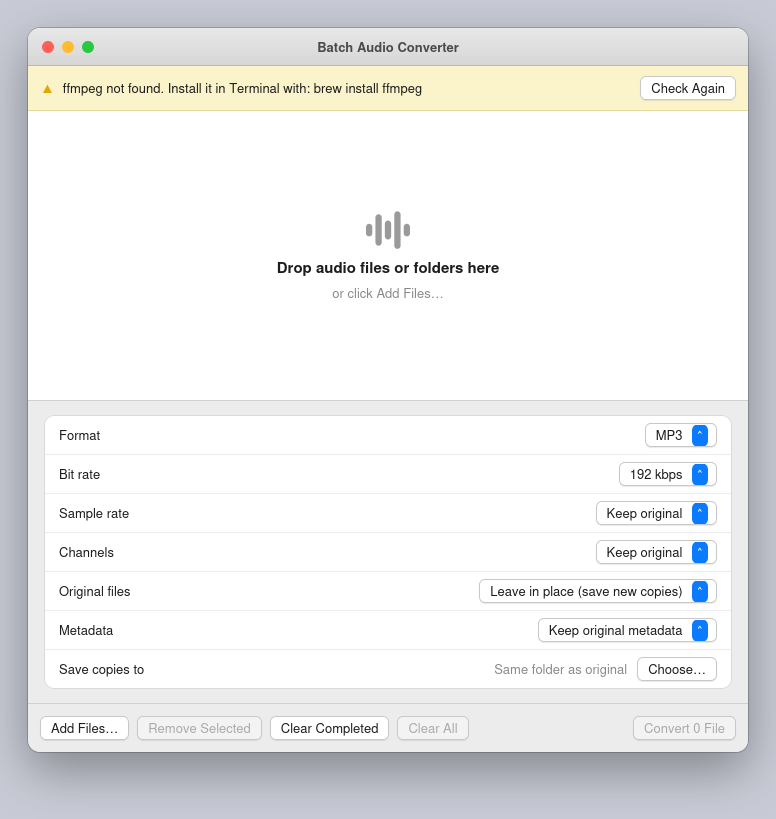
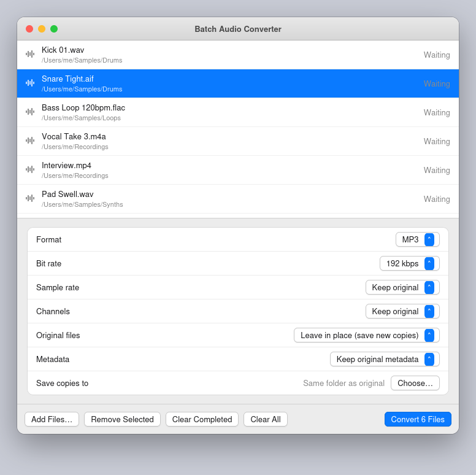
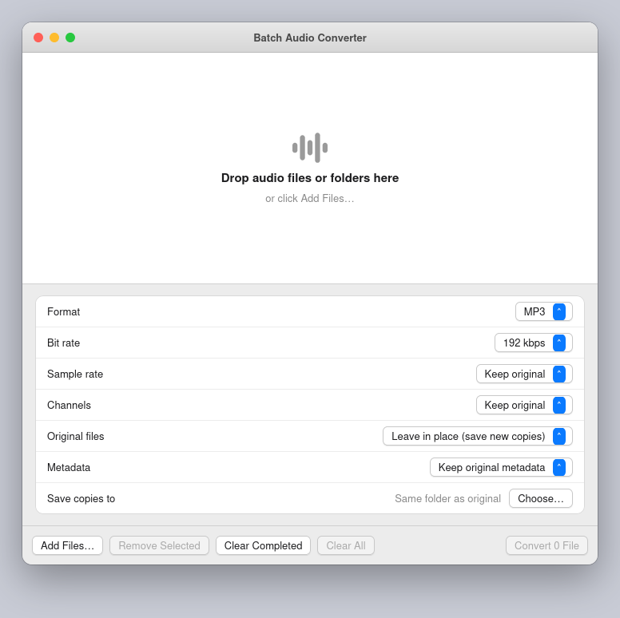
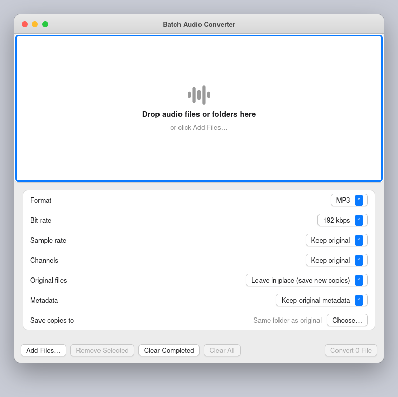
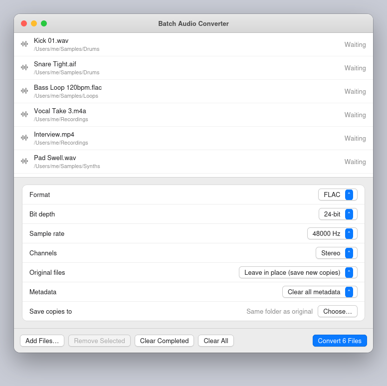
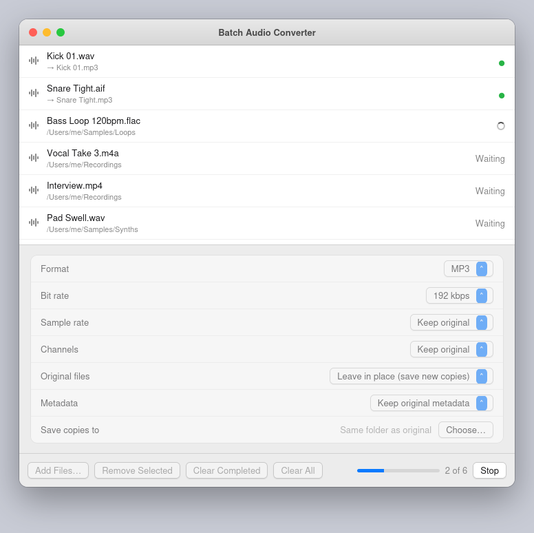
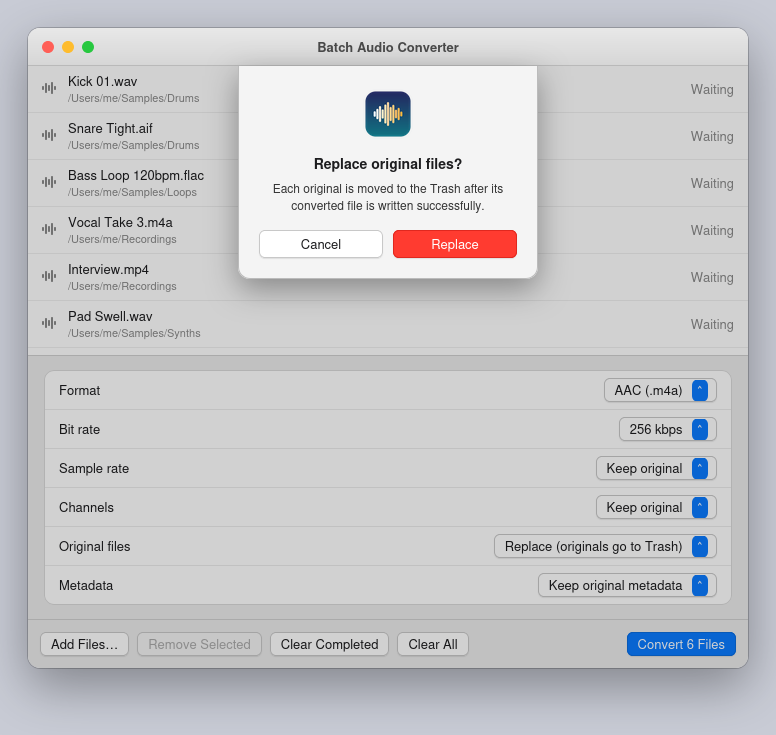
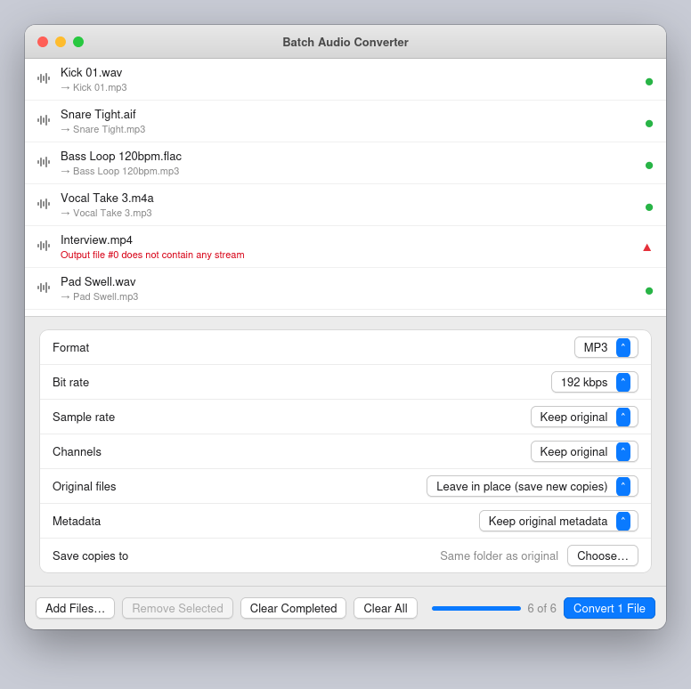

# Batch Audio Converter — User Manual

Batch Audio Converter is a small macOS app for converting lots of audio files at once. Drag in files or whole folders, choose a format and a few options, and click **Convert**. The actual conversion is done by [ffmpeg](https://ffmpeg.org), which is built into the app.

**Requires:** macOS 13 (Ventura) or newer (Apple Silicon or Intel). Nothing else to install.

> **Disclaimer — no warranty.** This software is provided **"as is"**, without warranty of any kind. It is free to use under the MIT License (see [LICENSE](../LICENSE)). The authors are not liable for any loss or damage, including lost, overwritten or corrupted audio files. **Back up anything you care about before converting, especially if you choose "Replace".**

---

## Contents

1. [Installing](#1-installing)
2. [The window at a glance](#2-the-window-at-a-glance)
3. [Adding files](#3-adding-files)
4. [Choosing settings](#4-choosing-settings)
5. [Converting](#5-converting)
6. [Replacing originals](#6-replacing-originals)
7. [Reading the results](#7-reading-the-results)
8. [Format reference](#8-format-reference)
9. [Tips and good to know](#9-tips-and-good-to-know)
10. [Troubleshooting](#10-troubleshooting)
11. [Disclaimer and license](#11-disclaimer-and-license)

---

## 1. Installing

1. Download `BatchAudioConverter-<version>-macOS.zip` from the project's **Releases** page and unzip it.
2. Drag **Batch Audio Converter.app** into your **Applications** folder.
3. The first time, **right-click the app, choose Open, then confirm.** The app isn't notarized by Apple, so macOS warns about it once. If macOS still refuses, run `xattr -dr com.apple.quarantine "/Applications/Batch Audio Converter.app"` in Terminal.

ffmpeg is bundled inside the app, so there is nothing else to install.

**Building from source?** See the README. If you build without the bundled ffmpeg, the app looks for one in `/opt/homebrew/bin`, `/usr/local/bin` or `/opt/local/bin`, and shows this banner if it finds none:

Install ffmpeg as shown (`brew install ffmpeg`) and click **Check Again**. Official release builds never show this banner.

---

## 2. The window at a glance

The window has three areas:

| Area | What it does |
|---|---|
| **File list** (top) | Shows every file queued for conversion, with its folder and current status. |
| **Settings** (middle) | Format, quality, sample rate, channels, what happens to the originals, and metadata. |
| **Button bar** (bottom) | Add, remove and clear files; shows progress; the **Convert** button. |

---

## 3. Adding files

When the list is empty you'll see the drop zone:

You can add files in two ways:

- **Drag and drop** files or folders onto the list. The list shows a blue outline when it's ready to receive them.
- Click **Add Files…** and pick files or folders in the standard macOS dialog.

Things to know:

- **Folders are scanned, including all subfolders.** Only files with an audio or video extension are added, and hidden files are skipped.
- Recognised extensions: `mp3 m4a m4b aac wav aif aiff aifc flac ogg oga opus wma caf ac3 eac3 amr mka mp2 wv ape dsf au webm mp4 mov`.
- **Duplicates are ignored.** Adding the same file twice does nothing.
- A file you drop directly is added even if its extension isn't in the list above. ffmpeg will simply report an error if it can't read it.
- **Video files** (`mp4`, `mov`, `webm`…) are accepted: the audio track is extracted and the video is discarded.
- If a file has several audio tracks, **only the first** is converted.

### Removing files from the list

- Select one or more rows (click, or ⌘-click / ⇧-click for several) and press **Remove Selected** or the **Delete** key.
- **Clear Completed** removes rows that finished successfully.
- **Clear All** empties the list.

These only remove entries from the queue. **They never delete audio files from your disk.**

---

## 4. Choosing settings

Settings sit in the middle of the window. Options appear or disappear depending on the format you pick.

### Format
MP3, AAC (.m4a), ALAC (.m4a, lossless), FLAC, WAV, AIFF, Ogg Vorbis or Opus. See the [format reference](#8-format-reference).

### Bit rate *(lossy formats only)*
MP3, AAC, Ogg Vorbis and Opus. Higher numbers sound better and make bigger files. 192 kbps is the default; 256–320 kbps is a safe choice for music, and 64–96 kbps is fine for speech.

### Bit depth *(lossless / PCM formats only)*
FLAC, ALAC, WAV and AIFF. The default is 24-bit. WAV and AIFF also offer 32-bit.

### Sample rate
**Keep original** leaves each file's rate alone. Otherwise pick a fixed rate, such as 44100 Hz (CD) or 48000 Hz (video). The list of available rates depends on the format. If you switch to a format that doesn't support your chosen rate, the setting falls back to **Keep original**.

### Channels
**Keep original**, **Mono** or **Stereo**. Converting to stereo from a mono file simply duplicates the signal; converting stereo to mono mixes the two sides together.

### Original files
- **Leave in place (save new copies)** — your originals are never touched. *(Default, and the safe option.)*
- **Replace (originals go to Trash)** — see [Replacing originals](#6-replacing-originals).

### Metadata
- **Keep original metadata** — copies tags (title, artist, album…) and, for MP3, AAC, ALAC and FLAC, embedded cover art.
- **Clear all metadata** — strips tags, chapters and cover art from the output.

### Save copies to
Shown only when originals are left in place. By default new files are saved **next to the originals**. Click **Choose…** to send them all to one folder instead (you can create a new folder from the dialog). Click **Reset** to go back to saving next to the originals.

> Settings apply to the whole batch and are not remembered after you quit the app.

---

## 5. Converting

1. Add your files.
2. Choose your settings.
3. Click **Convert N Files** (or press **Return**).

While conversion runs, the settings and most buttons are greyed out, files are processed one at a time, and each row shows a spinner, then a result:

Click **Stop** to cancel. The file currently being converted is allowed to finish, and the remaining files stay as **Waiting**. You can click **Convert** again later to carry on with the ones that are left.

### File names
The converted file keeps the original name with the new extension (`Kick 01.wav` → `Kick 01.mp3`). If a file with that name already exists in the destination, the app never overwrites it. It adds ` (converted)` instead, then ` (converted 2)`, and so on. This also applies when you convert a file to its own format in the same folder.

---

## 6. Replacing originals

If you choose **Replace (originals go to Trash)** and click Convert, the app asks you to confirm:

When replacing:

- The new file is written first. **Only if that succeeds** is the original moved to the **Trash** (not permanently deleted).
- The new file is saved in the same folder as the original, so the "Save copies to" option is hidden.
- If a conversion fails, that original stays exactly where it was.

Because originals go to the Trash, you can recover them with **Put Back** until you empty it. Even so, **keep a backup** of important recordings.

---

## 7. Reading the results

| Row shows | Meaning |
|---|---|
| **Waiting** | Queued, not converted yet. |
| Spinner | Being converted right now. |
| Green dot and **→ name** | Done. The arrow shows the file that was written. |
| Red triangle and message | Failed. The message is the last line ffmpeg reported. |

The button bar shows a progress bar and a count like **6 of 6**. Failed files remain in the queue, and the Convert button counts them, so after fixing the problem (or changing settings) you can simply click **Convert** again to retry only the failed and waiting files.

---

## 8. Format reference

| Format | Extension | Type | Bit rate | Bit depth | Cover art kept |
|---|---|---|---|---|---|
| MP3 | `.mp3` | Lossy | 64–320 kbps | – | Yes |
| AAC | `.m4a` | Lossy | 64–320 kbps | – | Yes |
| ALAC | `.m4a` | Lossless | – | 16, 24 | Yes |
| FLAC | `.flac` | Lossless | – | 16, 24 | Yes |
| WAV | `.wav` | Uncompressed | – | 16, 24, 32 | No |
| AIFF | `.aiff` | Uncompressed | – | 16, 24, 32 | No |
| Ogg Vorbis | `.ogg` | Lossy | 64–320 kbps | – | No |
| Opus | `.opus` | Lossy | 32–256 kbps | – | No |

**Available sample rates**

| Format | Rates (Hz) |
|---|---|
| MP3 | 8000, 11025, 12000, 16000, 22050, 24000, 32000, 44100, 48000 |
| Opus | 8000, 12000, 16000, 24000, 48000 |
| AAC, Ogg Vorbis | 8000, 11025, 16000, 22050, 32000, 44100, 48000, 88200, 96000 |
| FLAC, ALAC, WAV, AIFF | 8000, 11025, 16000, 22050, 32000, 44100, 48000, 88200, 96000, 176400, 192000 |

*Cover art is only copied when "Keep original metadata" is selected and the source isn't a video file.*

---

## 9. Tips and good to know

- **Lossy to lossless won't restore quality.** Converting an MP3 to FLAC or WAV makes a bigger file, but it can't bring back detail already thrown away.
- **Converting lossy to lossy** (for example MP3 to AAC) lowers quality a little each time. Work from the original lossless source when you can.
- **Raising the sample rate or bit depth** doesn't add quality either. It's mainly useful for compatibility with a particular device or project.
- **Test on a few files first,** especially before using Replace.
- Opus is excellent for speech and low bit rates, but not every player supports it.
- Temporary files are written as hidden files (starting with a dot) in the destination folder and are cleaned up automatically if a conversion fails.

---

## 10. Troubleshooting

**The Convert button is greyed out.**
Either the list is empty, every file has already finished, or (source builds only) no ffmpeg was found.

**A file failed.**
Read the red message under its name. Common causes are a corrupt file, a video with no audio track, an unsupported file type, or a destination folder you don't have permission to write to.

**macOS asks for permission to access a folder.**
That's normal the first time the app reads or writes in places like Documents, Desktop or external drives. Choose **Allow**.

**The app won't open ("unidentified developer").**
Right-click the app, choose **Open**, then confirm. This only happens with builds that weren't made on your own Mac.

**Nothing happens when I drop a file.**
Make sure you're dropping onto the file list area, and that the app isn't in the middle of a conversion.

---

## 11. Disclaimer and license

**NO WARRANTY.** Batch Audio Converter is distributed **"AS IS"**, without warranty of any kind, express or implied, including but not limited to the warranties of merchantability, fitness for a particular purpose and non-infringement. In no event shall the authors or copyright holders be liable for any claim, damages or other liability, whether in an action of contract, tort or otherwise, arising from, out of or in connection with the software or the use of or other dealings in the software. This includes, without limitation, loss, overwriting or corruption of audio files or other data. **You use this software entirely at your own risk. Back up your files.**

The software is released under the **MIT License**. See the [LICENSE](../LICENSE) file for the full text.

The **ffmpeg** program bundled in the app is a separate work and is **not** covered by the MIT License. It is built without GPL or non-free components and is licensed under the **LGPL v2.1 or later**, together with LAME (LGPL), libvorbis, libogg and libopus (BSD-style). The license texts are in the app at `Contents/Resources/Licenses`, and [THIRD_PARTY.md](../THIRD_PARTY.md) lists sources and how to rebuild or replace it. This app is not affiliated with or endorsed by the ffmpeg project or Apple.
